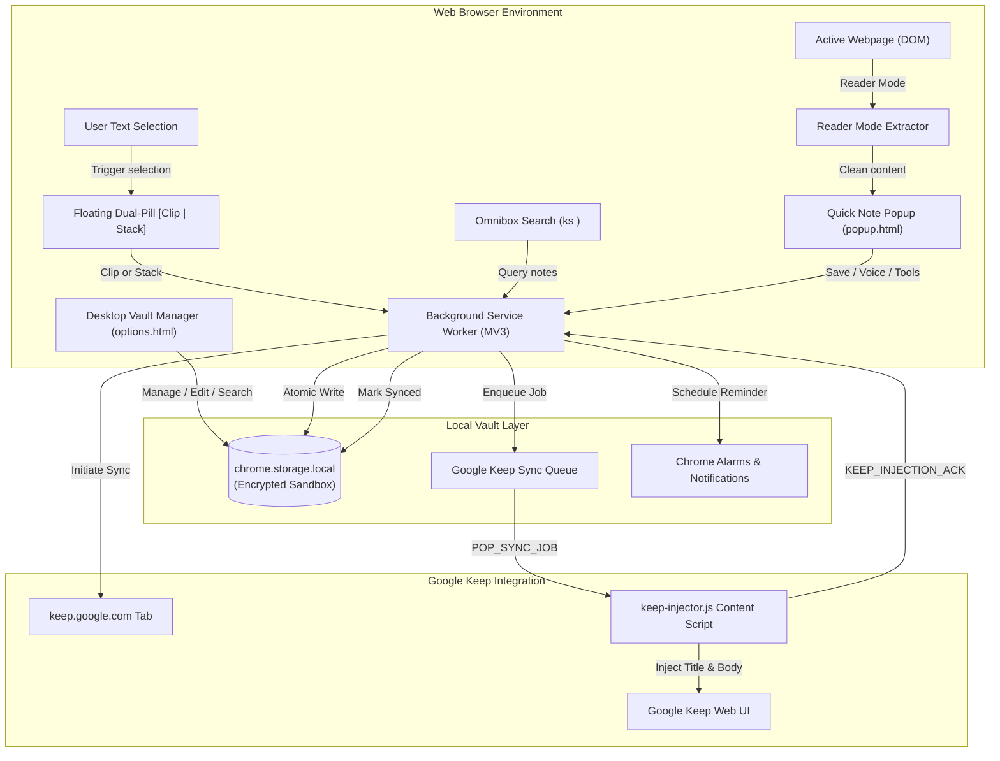

# ⚡ KeepSync - Notes, Snippets & Web Clipper for Google Keep

> **The ultimate high-performance, offline-ready notes vault and web clipper for Google Keep (Manifest V3).**  
> Capture notes, snippets, web links, full article reader views, and interactive checklists with zero latency, and seamlessly synchronize them into Google Keep.

---

## 🌟 Key Features

### 1. ✂️ Real-Time In-Page Web Clipper & Dual Action Bubble
- **Dual-Action Floating Bubble**: Selecting text on any website instantly shows:
  - `[ ⚡ Clip ]`: Creates a brand-new note with page attribution.
  - `[ + Stack ]`: Appends snippet into your current active working note (perfect for multi-quote research).
- **Smart Page Attribution**: Automatically records source URL, webpage title, and favicon alongside the clipped snippet.
- **Instant Hotkey Capture**: Press <kbd>Alt + Shift + S</kbd> anytime to clip highlighted text or bookmark the current web page.
- **In-Page Success Toasts**: Discreet notifications confirm your clip without interrupting your browsing flow.

### 2. 📄 Full Article Reader Mode Extraction
- **One-Click Reader Clip (`📄 Reader Clip`)**: Extracts clean, readable article body from news sites, blog posts, and documentation.
- **Noise Elimination**: Automatically strips advertisements, navigation menus, cookie banners, sidebars, and scripts.
- **Reading Metrics**: Calculates word count and estimated reading time directly in your note.

### 3. 🎙️ Voice Dictation (Hands-Free Notes)
- **Built-in Speech-to-Text**: Click the `Voice` chip in the quick editor to dictate meeting notes, spontaneous thoughts, or spoken ideas directly into text without needing typing or external API keys.

### 4. 🤖 Smart Transformation Utilities
- **⚡ Bullet Point Summarizer**: Intelligently condenses paragraphs and long clips into concise, high-impact takeaway bullet points.
- **☑️ Action Item / Task Extractor**: Automatically detects tasks (`TODO:`, `- [ ]`, `Action item:`, `check`, `review`) from meeting notes and transforms them into an interactive checklist.
- **💻 Developer Code Formatter**: Auto-detects programming languages (JavaScript, Python, HTML, CSS, SQL, JSON, Bash) and formats with proper indentation and Markdown syntax blocks.

### 5. ⏰ Scheduled Reminders & Native Alarms
- **Note Alarms**: Set reminders for notes (`Later Today`, `Tomorrow Morning`, `In 2 Days`, `Next Week`).
- **Native Chrome Notifications**: Triggers system alerts via `chrome.alarms` and `chrome.notifications` even when the popup is closed.
- **Reminder Filter & Badges**: Filter vault and dashboard notes by active reminders with visual badge timestamps.

### 6. 🔍 Chrome Omnibox Quick Search (`ks <query>`)
- **Address Bar Search**: Type `ks` + <kbd>Tab</kbd> or <kbd>Space</kbd> in Chrome's URL bar to search your entire notes vault from any tab with instant autocomplete suggestions.

### 7. 📝 Multi-Mode Note Creator & Authenticity
- **12 Signature Keep Color Palettes**: `Default`, `Coral`, `Peach`, `Sand`, `Mint`, `Sage`, `Fog`, `Storm`, `Dusk`, `Blossom`, `Clay`, and `Chalk`.
- **Theme Support**: Seamless **Dark Mode**, **Light Mode**, and **System Preference**.
- **Interactive Checklists**: Checkable to-do boxes with live completion tracking.
- **Priority Pinning**: Pin vital notes to anchor them at the very top.

### 8. 📚 Permanent Offline-First Notes Vault & Desktop Dashboard
- **Zero-Latency Storage**: Notes are persisted immediately to `chrome.storage.local`—100% private, no login required.
- **Full-Text Live Search**: Instant substring search across titles, note bodies, URLs, hashtags, and checklist items.
- **Automated Hashtags**: Type `#ideas`, `#work`, `#reading` to generate filterable tag chips.
- **Vault Analytics Strip**: Live overview of total words clipped, active notes, checklists, active alarms, and Keep sync percentage.

### 9. 🔄 Seamless Google Keep Sync Automation
- **Direct Web UI Automation**: Injects notes cleanly into your active `keep.google.com` session without fragile third-party API tokens.
- **Background Sync Queue**: Notes queue automatically when offline and sync as soon as Keep is reachable.
- **Batch Push**: One-click **"⚡ Sync All"** to push all pending vault notes to Keep in sequence.

### 10. 💾 Multi-Format Export & Safe Trash Bin
- **JSON Full Backup & Restore**: One-click backup and conflict-free merge restore.
- **Markdown (.md) Export**: Formatted documents with headers, source URLs, hashtags, and `- [x]` checkboxes.
- **CSV Spreadsheet Export**: Structured tabular export with columns for ID, Title, Type, Content, URL, Tags, Pinned, and Timestamps.
- **Two-Tier Trash**: Soft delete protection with instant restore and permanent purge capabilities.

---

## 🏛️ Architecture & Data Flow



---

## 📁 Project Directory Structure

```
E:\Goal\Extension\KeepSync - Notes, Snippets & Web Clipper for Google Keep\
├── manifest.json                  # Chrome Manifest V3 declaration
├── generate_icons.ps1             # High-res PNG & SVG icon generator
├── package_extension.ps1          # Production packaging (Unix forward-slash ZIP)
├── README.md                      # Complete documentation
├── background\
│   └── service-worker.js          # MV3 Service Worker (Omnibox, alarms, sync, menus)
├── content\
│   ├── keep-injector.js           # Google Keep DOM automation script
│   ├── keep-injector.css          # In-Keep sync status banner styling
│   ├── webpage-clipper.js         # Dual-action floating bubble & Reader Mode extractor
│   └── webpage-clipper.css        # In-page bubble & toast animation styles
├── lib\
│   └── storage.js                 # Storage layer, CRUD, smart AI tools, stats, export
├── popup\
│   ├── popup.html                 # Quick Note popup window with Smart Tools bar
│   ├── popup.css                  # Modern popup styling (Light/Dark themes)
│   └── popup.js                   # Popup controller (Voice, Reminders, Reader, Tools)
├── options\
│   ├── options.html               # Desktop Vault Manager with live analytics strip
│   ├── options.css                # Full-page dashboard grid & responsive styling
│   └── options.js                 # Options controller (bulk actions, stats, filters)
├── icons\
│   ├── icon16.png                 # Toolbar icon (16x16)
│   ├── icon32.png                 # Retina icon (32x32)
│   ├── icon48.png                 # Extension manager icon (48x48)
│   ├── icon128.png                # Chrome Web Store icon (128x128)
│   └── icon.svg                   # Master vector SVG source
├── test\
│   ├── test-runner.js             # 73 automated unit test assertions
│   └── test-page.html             # Interactive HTML test harness & playground
└── dist\
    └── KeepSync-Notes-Snippets-Web-Clipper-v1.0.0.zip # Chrome Web Store compliant package
```

---

## ⌨️ Keyboard Shortcuts & Omnibox

| Shortcut / Trigger | Description | Customizable |
| :--- | :--- | :---: |
| `ks` + <kbd>Tab</kbd> / <kbd>Space</kbd> | Search KeepSync vault directly from the Chrome address bar | Built-in |
| <kbd>Alt</kbd> + <kbd>Shift</kbd> + <kbd>K</kbd> | Open the KeepSync Quick Note popup window | Yes (`chrome://extensions/shortcuts`) |
| <kbd>Alt</kbd> + <kbd>Shift</kbd> + <kbd>S</kbd> | Instantly clip selected text or page link to Vault | Yes (`chrome://extensions/shortcuts`) |
| <kbd>Enter</kbd> (in checklist input) | Add checklist item and move to next row | Built-in |
| <kbd>Enter</kbd> (in tag input) | Commit hashtag to note | Built-in |
| <kbd>Esc</kbd> | Dismiss floating clip bubble or close modals | Built-in |

---

## 🛠️ Installation & Chrome Web Store Upload Guide

### Why Upload Failed Previously & How It's Fixed:
1. **Manifest Match Pattern**: Removed forbidden `chrome://*/*` pattern from `exclude_matches`.
2. **Scoped Permissions**: Scoped `host_permissions` strictly to `["https://keep.google.com/*"]`.
3. **Valid Icons**: Generated valid, square 16px, 32px, 48px, and 128px PNG icons.
4. **ZIP Archive Directory Separator**: Windows `Compress-Archive` generates backslashes (`\`) in ZIP file headers which the Chrome Web Store reject with upload parser errors. The build script now uses .NET `ZipArchive` to enforce Unix-compliant forward slashes (`/`).

### Option A: Upload to Chrome Web Store Developer Dashboard
1. Go to [Chrome Web Store Developer Dashboard](https://chrome.google.com/webstore/devconsole).
2. Click **Add new item**.
3. Upload the pre-built, forward-slash compliant ZIP file:
   ```
   E:\Goal\Extension\KeepSync - Notes, Snippets & Web Clipper for Google Keep\dist\KeepSync-Notes-Snippets-Web-Clipper-v1.0.0.zip
   ```
   *(Or the root `KeepSync - Notes, Snippets & Web Clipper for Google Keep.zip`)*.
4. The upload will validate with 0 errors!

### Option B: Load Unpacked in Chrome, Edge, or Brave (Developer Mode)
1. Open Chromium browser and navigate to `chrome://extensions/` (or `edge://extensions/`).
2. Toggle on **Developer mode** in the upper-right corner.
3. Click **Load unpacked**.
4. Select the project folder:
   ```
   E:\Goal\Extension\KeepSync - Notes, Snippets & Web Clipper for Google Keep
   ```
5. Pin the KeepSync extension in your toolbar!

---

## 🧪 Automated Testing & Verification

KeepSync includes a comprehensive test suite of **73 automated test assertions**:
- **Storage Layer**: Default settings, custom settings merging, note creation with automatic ID generation, empty title fallbacks, ISO timestamps.
- **Checklist Engine**: Item addition, state persistence, completion toggling.
- **Trash Lifecycle**: Soft deletes, restoration, permanent single deletes, bulk trashing, empty trash purging.
- **Search & Filters**: Multi-keyword search across titles, bodies, URLs, tags, and checklist rows; filtering by pinned status, color, and note types.
- **Hashtag Extraction**: Regex parsing of accented, alphanumeric, and underscored tags with de-duplication.
- **Google Keep Queue**: FIFO queue processing, duplicate suppression, and sync acknowledgement.
- **Export Engines**: JSON schema validation, Markdown document generation, CSV RFC-compliant escaping, and JSON backup restoration.
- **Multi-Snippet Stacking**: `appendToNote` and `getRecentActiveNote` research chaining.
- **Smart Utilities**: `extractActionItems`, `generateBulletSummary`, `formatCodeSnippet` with smart block indentation.
- **Alarms & Stats**: `reminderAt` filtering and `getVaultStats` aggregate calculations.

### Run Tests in Terminal:
```powershell
node "E:\Goal\Extension\KeepSync - Notes, Snippets & Web Clipper for Google Keep\test\test-runner.js"
```
*Output:*
```
====================================================
⚡ RUNNING KEEPSYNC COMPREHENSIVE TEST SUITE
====================================================
...
====================================================
🏁 TEST RESULTS: 73 PASSED, 0 FAILED
====================================================
🎉 ALL TESTS PASSED SUCCESSFULLY! 100% PASS RATE.
```

---

## 🔒 Privacy & Security Guarantee

- **100% Offline-First**: All notes are stored locally in your browser's private extension sandbox via `chrome.storage.local`.
- **Zero Third-Party Tracking**: No analytics trackers, no telemetry scripts, and no external server connections.
- **Direct Session Interaction**: Synchronization with Google Keep occurs directly within your local browser tab (`https://keep.google.com/*`) without sending your credentials or data through intermediary servers.

---

## 📄 License

MIT License. Designed and engineered for clean, rapid, and delightful personal knowledge management.
